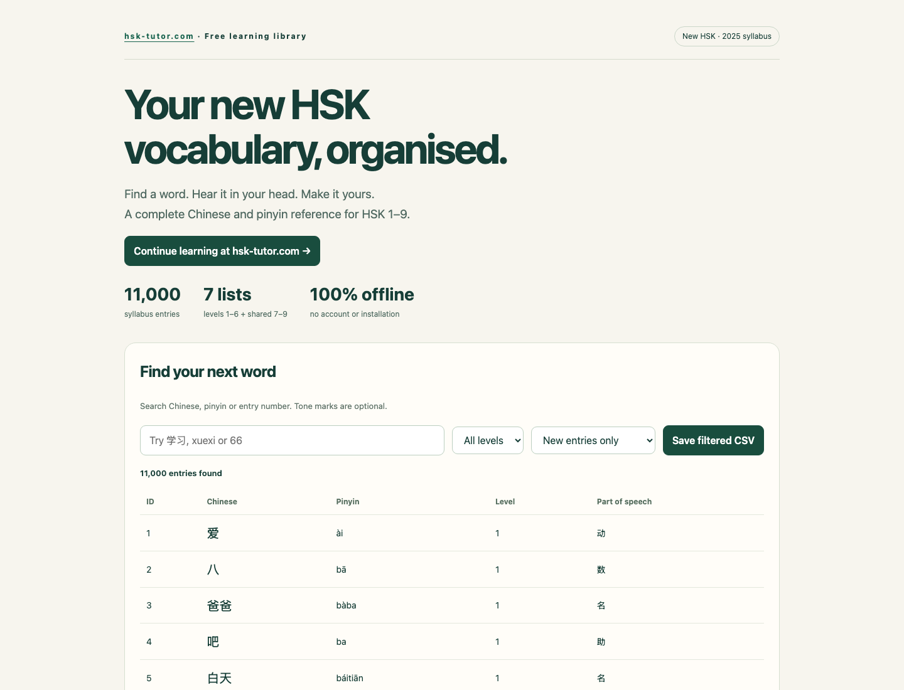
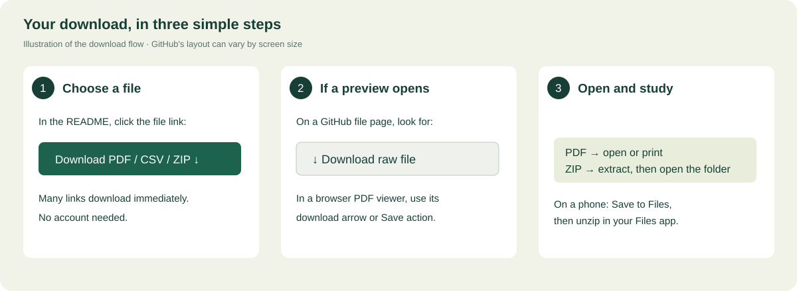

[](https://hsk-tutor.com/vocabulary?utm_source=github&utm_medium=referral&utm_campaign=hsk-3.0-vocabulary-dataset&utm_content=readme_cover)

# New HSK 3.0 Vocabulary List & Dataset — PDF, CSV, JSON

**Download the complete 11,000-entry new HSK vocabulary list from the November 2025 examination syllabus.** Chinese characters, pinyin, parts of speech and level labels for HSK 1–6 and the shared HSK 7–9 band. Free to access, with no account required.

**Keep learning → [Explore hsk-tutor.com](https://hsk-tutor.com/vocabulary?utm_source=github&utm_medium=referral&utm_campaign=hsk-3.0-vocabulary-dataset&utm_content=readme_top).** Download the free files below, or continue your practice on the website.

Prepared by **[hsk-tutor.com](https://hsk-tutor.com/?utm_source=github&utm_medium=referral&utm_campaign=hsk-3.0-vocabulary-dataset&utm_content=readme_credit)** · Source edition: **2025-11** · Dataset checked: **28 September 2026**.

**[Download the complete study pack · 8.4 MB](downloads/hsk-3.0-vocabulary-study-pack.zip?raw=true)** · [Complete PDF](pdf/hsk-1-9-complete-vocabulary.pdf?raw=true) · [CSV](data/hsk-3.0-all.csv?raw=true) · [JSON](data/hsk-3.0-all.json?raw=true)

The study pack includes a searchable vocabulary browser. Download and unzip it, then open **`browse.html`**. It works offline; no installation is needed. This edition is a Chinese/pinyin reference; **English definitions are not included**.

## Download HSK vocabulary lists by level

The **PDF** and **all words** columns include earlier levels for HSK 1–6. **New words** contains only entries first introduced at that level. HSK 7–9 is one shared advanced band.

| Level | New entries | Total through this level | Printable PDF | All words CSV | New words CSV / JSON |
|---|---:|---:|---|---|---|
| [HSK 1 vocabulary list](word-lists/hsk-1.md) | 300 | 300 | [HSK 1 PDF](pdf/hsk-1-vocabulary.pdf?raw=true) | [CSV](data/cumulative/hsk-1.csv?raw=true) | [CSV](data/by-level/hsk-1.csv?raw=true) · [JSON](data/by-level/hsk-1.json?raw=true) |
| [HSK 2 vocabulary list](word-lists/hsk-2.md) | 200 | 500 | [HSK 2 PDF](pdf/hsk-2-vocabulary.pdf?raw=true) | [CSV](data/cumulative/hsk-2.csv?raw=true) | [CSV](data/by-level/hsk-2.csv?raw=true) · [JSON](data/by-level/hsk-2.json?raw=true) |
| [HSK 3 vocabulary list](word-lists/hsk-3.md) | 500 | 1,000 | [HSK 3 PDF](pdf/hsk-3-vocabulary.pdf?raw=true) | [CSV](data/cumulative/hsk-3.csv?raw=true) | [CSV](data/by-level/hsk-3.csv?raw=true) · [JSON](data/by-level/hsk-3.json?raw=true) |
| [HSK 4 vocabulary list](word-lists/hsk-4.md) | 1,000 | 2,000 | [HSK 4 PDF](pdf/hsk-4-vocabulary.pdf?raw=true) | [CSV](data/cumulative/hsk-4.csv?raw=true) | [CSV](data/by-level/hsk-4.csv?raw=true) · [JSON](data/by-level/hsk-4.json?raw=true) |
| [HSK 5 vocabulary list](word-lists/hsk-5.md) | 1,600 | 3,600 | [HSK 5 PDF](pdf/hsk-5-vocabulary.pdf?raw=true) | [CSV](data/cumulative/hsk-5.csv?raw=true) | [CSV](data/by-level/hsk-5.csv?raw=true) · [JSON](data/by-level/hsk-5.json?raw=true) |
| [HSK 6 vocabulary list](word-lists/hsk-6.md) | 1,800 | 5,400 | [HSK 6 PDF](pdf/hsk-6-vocabulary.pdf?raw=true) | [CSV](data/cumulative/hsk-6.csv?raw=true) | [CSV](data/by-level/hsk-6.csv?raw=true) · [JSON](data/by-level/hsk-6.json?raw=true) |
| [HSK 7-9 vocabulary list](word-lists/hsk-7-9.md) | 5,600 | 11,000 | [PDF (new only)](pdf/hsk-7-9-vocabulary.pdf?raw=true) | [CSV](data/cumulative/hsk-7-9.csv?raw=true) | [CSV](data/by-level/hsk-7-9.csv?raw=true) · [JSON](data/by-level/hsk-7-9.json?raw=true) |

For a complete advanced checklist including earlier levels, use the [HSK 1–9 complete PDF](pdf/hsk-1-9-complete-vocabulary.pdf?raw=true). Cumulative JSON files are also available in [data/cumulative](data/cumulative).

Click a level name to **read the complete new-entry list directly on GitHub**, without downloading a file.



## How to download — no GitHub experience needed

1. **Click a PDF, CSV or ZIP link in the table above.** The file should open or download.
2. **If a PDF opens in your browser**, click the download arrow in that viewer. On a phone, use the browser's Share / Save to Files action.
3. **If GitHub shows a file page instead**, click the downward arrow labelled **Download raw file**, near the top right of the file.
4. **For the study pack:** unzip the downloaded ZIP, open the folder, then double-click `browse.html`. Search in Chinese or pinyin; use **Save filtered CSV** to keep your selection.



You do not need to sign in, clone a repository, install Git or press “Fork”. The download links are enough.

## What makes this list useful?

- **11,000 numbered syllabus entries**, with all source IDs from 1 through 11,000 present.
- **Both incremental and cumulative lists**, so you can study new words or review everything so far.
- **Tone-marked pinyin and original part-of-speech labels**, without replacing the syllabus reading with a dictionary guess.
- **Printable checklists** with room for your own meanings and examples.
- **An offline browser** with level filters, Chinese/pinyin search and filtered CSV downloads.
- **Source traceability:** every data record points to its physical page in the syllabus PDF.

Counts refer to numbered syllabus entries, not unique written forms. Some forms appear more than once with different readings or meanings.

## Which “new HSK” is this?

This repository follows the **HSK examination syllabus published in November 2025**. It is not the legacy 150/300/600-word HSK list and not the separate 2021 proficiency standard with 500 words at level 1. Here the cumulative totals are **300 → 500 → 1,000 → 2,000 → 3,600 → 5,400 → 11,000**.

HSK 7, 8 and 9 share one advanced vocabulary band; this dataset does not invent separate lists for those levels. Confirm the version of your booked exam with your test centre. [Official HSK information](https://www.chinesetest.cn/HSK) · [Edition and sources](SOURCES.md).

## Data format

CSV files use UTF-8 with a BOM so Chinese text opens correctly in common spreadsheet applications. JSON uses UTF-8. No API key, database or package installation is needed.

| Field | Meaning |
|---|---|
| `id` | Original numbered entry, 1–11,000; use this as the stable key. |
| `level` | First level/band in which the entry appears: `1` … `6`, or `7-9`. |
| `hanzi` | Chinese entry without a trailing homograph number. |
| `pinyin` | Reading copied from the syllabus, preserving its spelling and word spacing. |
| `part_of_speech` | Source Chinese labels; an empty value means the source has no label. |
| `entry` | Entry exactly as extracted, including homograph numbers such as `本1`. |
| `homograph` | Trailing homograph number, or `null` / blank if absent. |
| `level_label` | Full source label, including parentheses such as `1（4）`. |
| `source_pdf_page` | Physical PDF page number, starting at 1; not the printed page number. |

Part-of-speech key: 名 noun · 动 verb · 形 adjective · 副 adverb · 代 pronoun · 数 numeral · 量 measure word · 介 preposition · 连 conjunction · 助 particle · 叹 interjection · 拟声 onomatopoeia · 前缀 prefix · 后缀 suffix. Parentheses are retained from the source, including labels for additional uses at a later level.

```json
{"id":1,"level":"1","hanzi":"爱","pinyin":"ài","part_of_speech":"动","entry":"爱","homograph":null,"level_label":"1","source_pdf_page":80}
```


## A simple way to study

Choose your level, print the checklist and cover the pinyin. Read each word aloud and tick the ones you recognise. Add a meaning or your own sentence in the blank column. Revisit unticked words the next day.

Want guided vocabulary practice alongside this list? [Continue with hsk-tutor.com](https://hsk-tutor.com/vocabulary?utm_source=github&utm_medium=referral&utm_campaign=hsk-3.0-vocabulary-dataset&utm_content=readme_footer). The files here remain usable entirely on their own.

## HSK 3.0 vocabulary FAQ

### How many words are in the new HSK vocabulary list?

The November 2025 HSK examination syllabus contains **11,000 numbered vocabulary entries**. Cumulative totals are 300 for HSK 1, 500 for HSK 2, 1,000 for HSK 3, 2,000 for HSK 4, 3,600 for HSK 5 and 5,400 for HSK 6. The shared HSK 7–9 band adds 5,600 entries. These are syllabus entries; repeated written forms can have different readings or uses. [Source and edition](SOURCES.md).

### Does the new HSK 1 have 150, 300 or 500 words?

**This November 2025 examination syllabus has 300 HSK 1 entries.** The familiar 150-entry list belongs to the legacy HSK 2.0 syllabus. The 500-entry level-one list belongs to the separate 2021 proficiency standard. Check the edition before combining lists: they use different level boundaries.

### Where can I download an HSK vocabulary PDF, CSV or JSON?

Use the [level download table](#download-hsk-vocabulary-lists-by-level) above. PDFs are printable study checklists; CSV files open in spreadsheet applications; JSON is for importing into your own tools. For browsing without installing anything, download the complete study pack and open `browse.html` after extracting it.

### Do I need earlier levels when studying HSK 4 or HSK 5?

For a cumulative checklist, yes: use the **all words** CSV or the corresponding PDF. The new HSK 4 list adds 1,000 entries to the earlier 1,000, for 2,000 total. HSK 5 adds another 1,600, for 3,600 total. The **new words** files are useful when you already know earlier levels.

### Are pinyin, English definitions and audio included?

Tone-marked pinyin and source parts of speech are included. English definitions and word audio are not included in this edition. The PDF has space for your own meanings and examples. This preserves the syllabus reference without presenting guessed definitions as official translations.

## Help improve the list

Found a transcription error? Open an issue with the **entry ID**, the suggested correction and the source page. Please check homograph and parenthetical level labels before proposing a merge. If this resource helps your studies, a star makes it easier to find again.

Source materials are credited in [SOURCES.md](SOURCES.md); reuse details are in [LICENSE.md](LICENSE.md). This is an independent project, not an official HSK publication.
